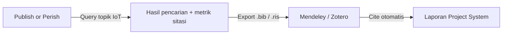
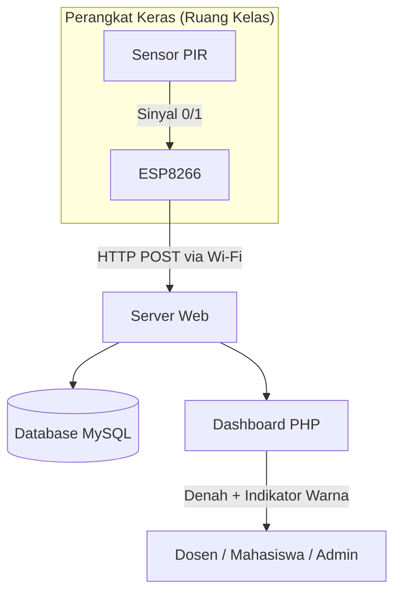
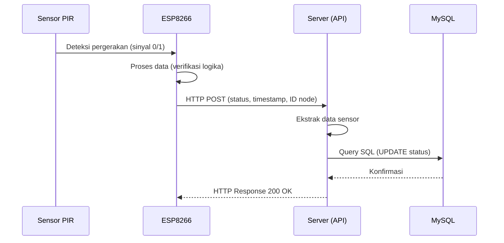

## Ringkasan

Dokumen ini merupakan catatan (*notes*) pemenuhan **Tugas Pertemuan Pertama** mata kuliah **Project Sistem**, Program Studi Teknik Informatika, Universitas Muhammadiyah Cirebon. Seluruh instruksi tugas telah diselesaikan sebelum tenggat pukul **09.00**, dan laporan ini disusun sebagai bukti serta rekam jejak pengerjaan.

Berikut ringkasan status pengerjaan:

| No | Instruksi Tugas | Status | Keterangan |
|:--:|:----------------|:------:|:-----------|
| 1 | Pembuatan Akun Google Scholar | ✅ Selesai | Digunakan untuk pencarian referensi ilmiah dan pengelolaan sitasi |
| 2 | Pembuatan Akun Mendeley & Zotero | ✅ Selesai | Mendeley untuk manajemen *library* utama, Zotero sebagai alternatif |
| 3 | Install Publish or Perish | ✅ Selesai | Digunakan untuk analisis sitasi dan pencarian literatur via Google Scholar |
| 4 | Persiapan Website Perkuliahan | ✅ Selesai | Website berbasis **Hugo** sebagai media publikasi materi dan tugas kuliah |
| 5 | Pemilihan Tema Penelitian | ✅ Selesai | Memilih tema **c. Jaringan Komputer / IoT** |

---

## 1. Akun Google Scholar

Google Scholar dibuat untuk mendukung proses pencarian referensi ilmiah, pengecekan sitasi, dan pemantauan publikasi akademik. Akun ini terhubung dengan email kampus dan akan digunakan sepanjang pengerjaan Project System.

**Kegunaan utama dalam konteks project:**

- Mencari jurnal penelitian terdahulu yang relevan dengan topik IoT dan *smart campus*.
- Memverifikasi reputasi dan jumlah sitasi suatu publikasi sebelum dijadikan rujukan.
- Menjadi sumber data untuk *literature review* pada Bab II proposal.

---

## 2. Akun Mendeley & Zotero

Kedua *reference manager* ini dipersiapkan sebagai alat bantu dalam mengelola daftar pustaka.

### Mendeley
- Digunakan sebagai **manajer referensi utama**.
- Mendukung impor metadata langsung dari Google Scholar dan PDF.
- Terintegrasi dengan Microsoft Word melalui *Mendeley Cite* untuk pembuatan sitasi otomatis (format APA/IEEE).

### Zotero
- Dipersiapkan sebagai **alternatif cadangan**.
- Keunggulan pada *browser connector* yang cepat menangkap metadata dari halaman web jurnal.
- Berguna untuk menyimpan *snapshot* halaman referensi secara utuh.

Dengan dua alat ini, penulisan daftar pustaka pada laporan Project System dapat dilakukan secara konsisten dan terhindar dari kesalahan format.

---

## 3. Publish or Perish (PoP)

Publish or Perish telah di-*install* dan dikonfigurasi menggunakan sumber data **Google Scholar**. Perangkat lunak ini akan dimanfaatkan untuk:

- Menghitung metrik sitasi (*h-index*, *g-index*) dari kandidat referensi.
- Menelusuri penelitian terdahulu yang membahas topik serupa.
- Mengekspor hasil pencarian ke format `.bib` atau `.ris` agar dapat diimpor ke Mendeley/Zotero.

Alur kerja yang direncanakan:



---

## 4. Website Perkuliahan

Website perkuliahan disiapkan menggunakan **Hugo** (generator situs statis) dengan alasan:

- Proses *build* cepat dan ringan.
- Konten ditulis dalam format **Markdown**, sehingga mudah didokumentasikan.
- Mudah di-*deploy* ke hosting statis (GitHub Pages / Netlify).
- Mendukung *front matter* untuk kategorisasi dan penandaan (*tagging*) setiap tugas.

Struktur direktori konten yang digunakan:

```text
content/
└── posts/
    ├── tugas-pertemuan-pertama.md
    └── ...
static/
└── img/
    ├── iot-mapping.jpeg
    └── ...
```

Website ini akan menjadi wadah publikasi seluruh materi perkuliahan dan laporan tugas selama satu semester.

---

## 5. Tema Penelitian yang Dipilih

> **Tema: c. Jaringan Komputer / Internet of Things (IoT)**

### Judul Project System

**Sistem Informasi Mapping dan Monitoring Ketersediaan Ruang Kelas Berbasis IoT (Studi Kasus: Universitas Muhammadiyah Cirebon)**

### Alasan Pemilihan Tema

1. **Relevansi dengan permasalahan nyata di kampus.** Jadwal statis yang ditempel di awal semester sering tidak sesuai kondisi lapangan ketika terjadi perubahan jadwal, kelas pengganti, atau pembatalan kuliah.
2. **Kombinasi dua bidang keilmuan.** Penelitian ini menggabungkan *hardware* (mikrokontroler dan sensor) dengan *software* (sistem informasi berbasis web), sehingga mencakup ranah jaringan komputer sekaligus rekayasa perangkat lunak.
3. **Mendukung konsep Smart Campus** yang sedang diarahkan pada lingkungan Universitas Muhammadiyah Cirebon.
4. **Kelayakan implementasi** relatif tinggi karena komponen yang digunakan (ESP8266 dan sensor PIR) murah dan mudah diperoleh.

---

## 6. Ringkasan Substansi Project

### 6.1 Latar Belakang

Peningkatan jumlah mahasiswa Universitas Muhammadiyah Cirebon berbanding lurus dengan intensitas penggunaan ruang kelas. Namun, pemantauan penggunaan ruang kelas masih bersifat **konvensional** dan bergantung pada **jadwal statis**. Akibatnya:

- Mahasiswa dan dosen harus mendatangi ruangan satu per satu untuk mengetahui statusnya.
- Jadwal statis tidak merepresentasikan kondisi aktual (misalnya kelas selesai lebih cepat atau dibatalkan).
- Pengecekan manual tidak efisien dari segi waktu dan tenaga.

Solusi yang ditawarkan adalah **sistem pemantauan otomatis berbasis IoT** dengan sensor keberadaan yang terintegrasi ke dashboard web, menampilkan **denah gedung digital** (*indoor mapping*) dengan indikator warna status ruangan.

### 6.2 Rumusan Masalah

1. Bagaimana merancang bangun perangkat IoT yang mampu mendeteksi keberadaan pengguna di dalam ruang kelas secara *real-time*?
2. Bagaimana membangun sistem informasi berbasis web yang dapat menampilkan visualisasi denah ketersediaan ruang kelas di UMC?
3. Bagaimana mengintegrasikan data sensor IoT ke dalam *dashboard* web agar status ruangan ter-*update* otomatis tanpa input manual?

### 6.3 Tujuan Penelitian

1. Merancang dan membangun perangkat keras IoT menggunakan **ESP8266** dan **sensor PIR** untuk deteksi keberadaan pengguna secara *real-time*.
2. Membangun **dashboard web** yang memvisualisasikan denah gedung UMC sebagai penanda status ketersediaan ruang kelas.
3. Mengimplementasikan integrasi antara perangkat sensor dan server web agar perubahan status ter-*update* otomatis.

### 6.4 Batasan Masalah

| Aspek | Batasan |
|:------|:--------|
| Objek | Studi kasus di Universitas Muhammadiyah Cirebon (implementasi prototipe pada ruang kelas terpilih) |
| Perangkat Keras | Mikrokontroler **ESP8266** dan sensor **PIR** (*Passive Infrared*) |
| Sistem Mapping | *Indoor mapping* (denah lantai digital), bukan GIS berskala luas |
| Perangkat Lunak | **PHP** dan basis data **MySQL** |
| Indikator Status | Dua kondisi: **Terisi** (merah) dan **Kosong** (hijau) |
| Konektivitas | Memerlukan jaringan Wi-Fi yang stabil di area kelas |

### 6.5 Manfaat Penelitian

**Teoretis**
- Menjadi referensi bagi penelitian selanjutnya terkait IoT untuk konsep *Smart Campus*.
- Memperluas wawasan mengenai integrasi *sensor hardware* dengan sistem informasi berbasis web dalam konteks *indoor mapping*.

**Praktis**
- **Mahasiswa & Dosen:** kemudahan mencari ruang kelas kosong secara *real-time* tanpa pengecekan fisik.
- **Universitas:** mendukung terwujudnya *Smart Campus* melalui manajemen fasilitas yang lebih modern dan transparan.
- **Penulis:** sarana implementasi ilmu pemrograman web, jaringan komputer, dan mikrokontroler.

---

## 7. Landasan Teori Singkat

### 7.1 Sistem Informasi
Kombinasi teknologi informasi dan aktivitas manusia yang menggunakannya untuk mendukung operasi dan manajemen. Pada penelitian ini, sistem informasi berperan mengolah data mentah sensor menjadi informasi visual (status ruangan) yang berguna bagi pengguna.

### 7.2 Mapping Digital (Indoor Mapping)
Proses visualisasi data spasial atau denah lokasi ke dalam format digital. Dalam penelitian ini, pemetaan **tidak** merujuk pada pemetaan geografis bumi (GIS), melainkan **denah lantai gedung** untuk menunjukkan posisi ruang kelas secara spesifik.

### 7.3 Internet of Things (IoT)
Konsep di mana objek fisik memiliki kemampuan mentransfer data melalui jaringan tanpa memerlukan interaksi manusia ke manusia. Arsitektur sistem terdiri dari **Node** (perangkat sensor) yang mengirim data status ruangan ke **Server** (*web dashboard*) melalui koneksi nirkabel.

### 7.4 Mikrokontroler ESP8266
Modul mikrokontroler dengan kemampuan Wi-Fi terintegrasi. Umum digunakan dalam pengembangan IoT karena dapat terhubung langsung ke internet (*stand-alone*) tanpa mikrokontroler tambahan.

### 7.5 Sensor PIR (*Passive Infrared*)
Sensor yang mendeteksi keberadaan berdasarkan **pergerakan objek** melalui pancaran inframerah pasif dari tubuh manusia.

### 7.6 Stack Teknologi

| Lapisan | Teknologi |
|:--------|:----------|
| Firmware perangkat | C/C++ (Arduino IDE) |
| Backend dashboard | PHP |
| Basis data | MySQL |
| Antarmuka pengguna | HTML, CSS, JavaScript (Web Browser) |

---

## 8. Perancangan Sistem

### 8.1 Arsitektur Umum



### 8.2 Aktor Sistem (Use Case)

| Aktor | Peran |
|:------|:------|
| **Mahasiswa & Dosen** | Melihat *mapping* denah ruangan secara *real-time* |
| **Admin** | Mengelola data master ruang kelas dan konfigurasi node |
| **Perangkat Sensor IoT** | Mengirim data logika pergerakan (0/1) |

### 8.3 Alur Aktivitas Pengiriman Data



### 8.4 Perancangan Basis Data

**Tabel `ruang_kelas`** — menyimpan data master identitas ruangan beserta status ketersediaan saat ini.

| Field | Tipe | Keterangan |
|:------|:-----|:-----------|
| `id_ruang` | VARCHAR (PK) | Kode unik ruangan |
| `nama_ruang` | VARCHAR | Nama atau nomor ruang kelas |
| `lokasi_gedung` | VARCHAR | Nama gedung atau lantai |
| `status_ketersediaan` | ENUM('Kosong','Terisi') | Indikator kondisi *real-time* |
| `last_update` | TIMESTAMP | Waktu pembaruan data terakhir dari IoT |

**Tabel `log_sensor`** — merekam riwayat perubahan kondisi yang ditangkap sensor.

| Field | Tipe | Keterangan |
|:------|:-----|:-----------|
| `id_log` | INT (PK, AI) | ID log |
| `id_ruang` | VARCHAR (FK) | Relasi ke `ruang_kelas` |
| `logika_gerak` | TINYINT | 1 = ada gerakan, 0 = tidak ada |
| `waktu_log` | TIMESTAMP | Waktu pencatatan |

### 8.5 Perancangan Input

1. **Input Otomatis (Hardware)** — sinyal logika `HIGH (1)` atau `LOW (0)` dari sensor PIR berdasarkan deteksi pancaran inframerah dari pergerakan manusia, dikirim mikrokontroler via protokol HTTP POST/GET ke server.
2. **Input Manual (Admin Web)** — formulir berbasis web untuk menambah, mengubah, atau menghapus data master ruang kelas serta memetakan koordinat denah gedung.

### 8.6 Perancangan Output

- **Indikator warna status:** ruangan **Terisi** berwarna **merah**, ruangan **Kosong** berwarna **hijau**.
- **Informasi tambahan:** nama ruangan, lokasi lantai, serta waktu terakhir data diperbarui dari node sensor.

---

## 9. Rencana Implementasi

### 9.1 Perangkat Keras

| Komponen | Fungsi |
|:---------|:-------|
| Mikrokontroler **ESP8266** | Unit pemroses utama dengan modul Wi-Fi internal |
| Sensor **PIR** | Pendeteksi keberadaan manusia berbasis pergerakan |
| Router Wi-Fi Kampus | Media transmisi jaringan nirkabel lokal di area kelas |
| Komputer Server / Cloud Hosting | Menampung database dan web server *dashboard* |

### 9.2 Perangkat Lunak

| Perangkat | Fungsi |
|:----------|:-------|
| **PHP** | Pengembangan *backend* dashboard yang dinamis |
| **MySQL** | Sistem manajemen basis data relasional |
| **Arduino IDE (C/C++)** | Penulisan program dan *flashing firmware* ke ESP8266 |
| **Web Browser** | Antarmuka pengguna mengakses dashboard monitoring |

### 9.3 Pelaksana (*Brainware*)

| Peran | Tanggung Jawab |
|:------|:---------------|
| **Administrator Sistem** (Staf IT/Akademik) | Pemeliharaan web server, pengelolaan master data ruangan, konfigurasi teknis alat |
| **Dosen** | Pengguna akhir — mencari ruang kelas pengganti atau ruang rapat kosong |
| **Mahasiswa** | Pengguna akhir — memantau status keterpakaian kelas secara *real-time* |

---

## 10. Penelitian Terdahulu (Ringkasan)

Beberapa penelitian sejenis yang menjadi referensi awal:

| No | Penulis (Tahun) | Fokus Penelitian | Perbedaan dengan Penelitian Ini |
|:--:|:----------------|:-----------------|:--------------------------------|
| 1 | Syifa Chairunnisa Azzahra SRG, dkk. (2025) | Monitoring ketersediaan ruang kelas berbasis LoRa | Menggunakan LoRa + ESP32; penelitian ini menggunakan ESP8266 berbasis Wi-Fi dengan fokus visualisasi denah digital |
| 2 | Via Khusnul Pratifi, dkk. (2024) | Integrasi DHT11 + PIR untuk otomatisasi suhu dan deteksi gerakan | Fokus pada kontrol suhu/kipas; penelitian ini pada pemantauan status ketersediaan ruang kelas |
| 3 | Krisna Gilang Prakoso & Bonda Sisehaputra (2024) | Monitoring ruang kuliah berbasis NFC | Memerlukan *tapping* kartu e-KTP; penelitian ini memakai PIR tanpa interaksi fisik |
| 4 | Safarudin, dkk. (2023) | Smart classroom dengan RFID berbasis IoT | Fokus pada kendali akses pintu (*auto-lock*); penelitian ini pada penyajian visual status ruangan |
| 5 | Joko Riyanto, dkk. (2020) | Monitoring ruang kelas berbasis IoT di Universitas Pamulang | Menggunakan Raspberry Pi + LDR; penelitian ini ESP8266 + PIR |
| 6 | Ferdinand Tri Wibowo (2010) | Sistem informasi multimedia visualisasi pemakaian ruang kelas | Visualisasi berbasis jadwal statis; penelitian ini dinamis dari data sensor *real-time* |
| 7 | Annisa Dwita Aurum (2021) | Monitoring laboratorium dengan sensor *optical fingerprint* | Menggunakan sidik jari; penelitian ini PIR tanpa data biometrik |
| 8 | Dyna Marisa Khairina, dkk. (2018) | SIMERU — manajemen reservasi ruang (FKTI Universitas Mulawarman) | Aplikasi desktop untuk reservasi; penelitian ini berbasis IoT dan web untuk kondisi aktual |
| 9 | Indah Purnama Sari, dkk. (2025) | Smart Class berbasis IoT (pengenalan wajah + deteksi asap) | Fokus pada face recognition via ESP32-Cam; penelitian ini pada efisiensi *indoor mapping* |
| 10 | Siti Nur Aini, dkk. (2022) | Smart parking dengan RFID + Arduino Uno | Objek pada slot parkir; penelitian ini mengadopsi konsep serupa untuk ruang kelas |

---

## 11. Kesimpulan & Saran

### 11.1 Kesimpulan

- **Efisiensi pengecekan:** sistem menggantikan proses pengecekan kelas manual yang tidak efisien dengan visualisasi pemetaan digital secara *real-time*.
- **Otomatisasi perangkat:** kombinasi ESP8266 dan sensor PIR efektif mendeteksi keberadaan pengguna dan mengirimkannya via jaringan nirkabel.
- **Visualisasi intuitif:** dashboard web menyajikan informasi ketersediaan ruangan melalui indikator warna yang mudah dipahami (merah = terisi, hijau = kosong).
- **Pembaruan otomatis:** integrasi perangkat keras dan basis data berjalan mulus, status ruangan selalu ter-*update* tanpa intervensi manual.

### 11.2 Saran Pengembangan

1. **Aplikasi mobile** (Android/iOS) dengan fitur *push notification* saat ruang kelas kosong.
2. **Penambahan sensor** suhu (DHT) dan cahaya (LDR) untuk mendukung kendali perangkat listrik otomatis demi efisiensi energi.
3. **Peningkatan skalabilitas:** penyempurnaan desain *casing* perangkat keras dan penerapan catu daya cadangan (baterai) untuk implementasi di seluruh gedung kampus.

---

Dokumen ini akan diperbarui seiring berjalannya tahapan Project System berikutnya (analisis kebutuhan, perancangan detail, implementasi prototipe, dan pengujian).

> File Project System:\
> [Project System.pdf](./file/240511053_Project%20Sistem_Muhammad%20Rozaan.pdf)
